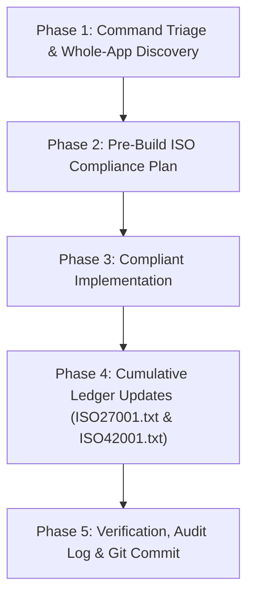

# ISO/IEC 27001:2022 & ISO/IEC 42001:2023 Universal Compliance Directive

> **Mandatory Standard Operating Procedure for all Web Applications, APIs, Cloud Functions, and AI Agents built by AI Foundation Australia.**

---

## 1. Executive Purpose & Scope

This directive mandates that **every web application, microservice, database schema, API endpoint, UI component, and AI workflow** created or maintained across all projects must natively incorporate and document compliance with:

1. **ISO/IEC 27001:2022 (including Amendment 1:2024)** — Information Security, Cybersecurity and Privacy Protection (clauses 4–10 and all 93 Annex A controls).
2. **ISO/IEC 42001:2023 (+ ISO/IEC 42005:2025)** — Artificial Intelligence Management System (AIMS) and AI System Impact Assessments (clauses 4–10 and all 38 Annex A controls).

Compliance is **never an afterthought** or a one-time audit. It is a live, cumulative gate embedded into every development turn.

---

## 2. Core Mandatory Rule: The Twin Ledgers

In the **root directory** of every web application project, two plain-text audit files must exist and be kept current on every commit:

1. `./ISO27001.txt` — Full-app Information Security Management System (ISMS) architecture and feature matrix.
2. `./ISO42001.txt` — Full-app Artificial Intelligence Management System (AIMS) architecture, model inventory, and AI impact assessments.

### Invariant Rules for Both Files
- **Format:** Plain text (`.txt`) with clean ASCII dividers (`===` and `---`) for direct human readability without Markdown processors.
- **Coverage:** Whole-app coverage. Both files must document the **entire** application, listing every feature, route, API, database collection, and third-party integration.
- **Bi-Directional Justification:** Every feature entry must document both:
  - **Controls Met & Implementation Evidence:** Citing exact workspace relative file paths, function names, and schema rules.
  - **Controls Not Affected & Justification:** Explaining why specific controls or domains do not apply (Statement of Applicability rationale).
- **Zero Fabrication:** Never claim compliance without verified code or architecture backing. If a control requires a human organizational policy (e.g. employee background checks or signed vendor DPAs), record it under **Residual Risks & Human/Organizational Actions Required**.

---

## 3. The 5-Phase Development Protocol

Execute this protocol on **every** command that adds, alters, or deploys code:

### Phase 1: Command Triage & Whole-App Discovery
- Check whether `./ISO27001.txt` and `./ISO42001.txt` exist. If absent, scan the repository completely (routes, auth, database, cloud functions, third-party APIs) and establish the baseline ledgers.
- Classify scope:
  - **ISO 27001:** Auth, RBAC, PII, multi-tenancy, secrets, financial transactions, file uploads, cloud dependencies.
  - **ISO 42001:** Models called, prompts, algorithmic scoring/ranking (Automated Decision-Making - ADM), datasets, agent tools.
  - App role: `AI Provider`, `AI Producer`, `AI Customer/Deployer`, or `Not AI-Affected`.

### Phase 2: Pre-Build ISO Compliance Plan
Formulate technical decisions before touching source code:
- **A.5 Organisational:** Role-based access control, supplier tracking, Australian Privacy Principles (APP) compliance.
- **A.6 People:** Separation of duties (Superadmin vs Merchant vs Agent vs User).
- **A.7 Physical:** Inherited cloud physical security (Google Cloud, AWS, Vercel).
- **A.8 Technological:**
  - Zero hardcoded secrets (Google Secret Manager or environment variables; strict `.gitignore` lock).
  - Strict input schemas (`additionalProperties: false`, Zod/JSON schema in `data-contracts.MD`).
  - Integer-only token economies (`Math.round`, no floating-point rounding errors).
  - Data leakage prevention (strip PII from logs, client errors, and public payloads).
- **A.2–A.10 AI Governance (ISO 42001):**
  - Conduct AI System Impact Assessment (Individual, Bias/Demographic, Societal).
  - Human-in-the-Loop (HITL) gates for content publishing and moderation.
  - Compatibility with low-cost MCP models (Gemini 3.5 Flash-Lite, Claude Haiku 4.5, gpt-6-luna).
  - Transparent ADM disclosures (e.g. search ranking formulas).

### Phase 3: Compliant Implementation
- Build strictly to the Phase 2 plan.
- Never write permissive database rules (e.g. `allow read, write: if true;`).
- Never store binary uploaded files on web app application servers; use client-side offscreen canvas pre-processing (16:9 crop) and dedicated CDNs.

### Phase 4: Ledger Updates
Update both `./ISO27001.txt` and `./ISO42001.txt`:
- Add or update the feature block with real file paths and exact evidence.
- Include chronological entry in Section 4 of both files.

### Phase 5: Verification & Clean Commit
- Run production build (`npm run build`) and test suites.
- Verify that `.env*` (except `.env.example`) and `safetyprotocols.txt` are git-ignored.
- Commit clean working tree and push to GitHub.

---

## 4. How to Apply This to Any New or Existing Web App

When starting or opening any project:

1. **Verify Global Skill Availability:**
   - The skill `iso-compliance-architect` is permanently installed in your global Antigravity environment at:
     `C:\Users\david\.gemini\config\skills\iso-compliance-architect\SKILL.md`
2. **Execute Baseline Scan:**
   - Ask Antigravity or execute:
     `Initialize ISO27001 and ISO42001 baseline compliance scan`
3. **Keep the Dev Server Open:**
   - Always find an open port and run `npm run dev` to monitor changes in real time.
4. **Never Bypass the Compliance Gate:**
   - Every subsequent code change will automatically update both ledgers.
